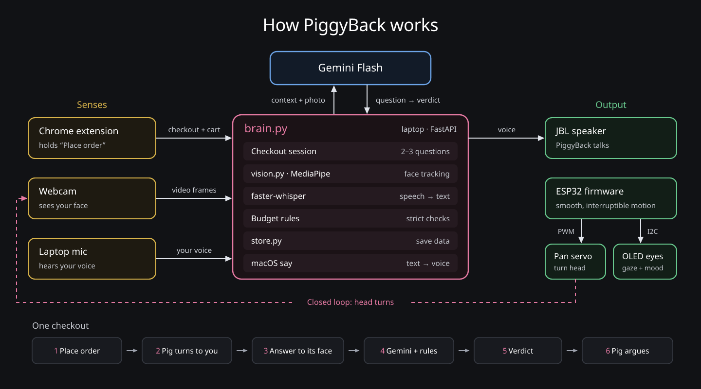
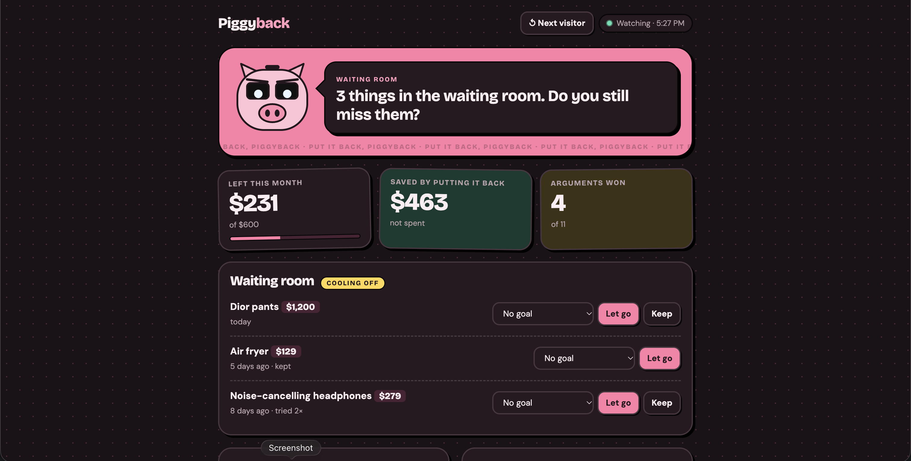
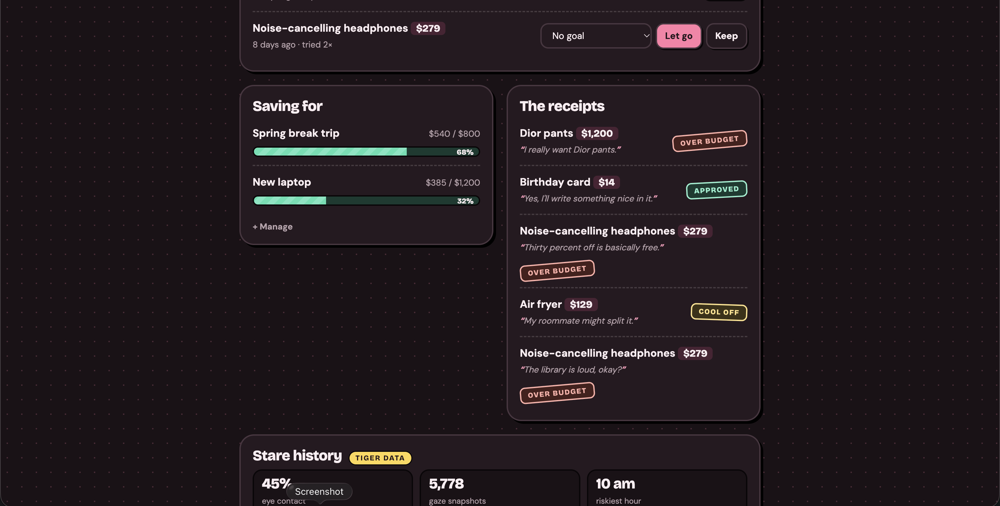
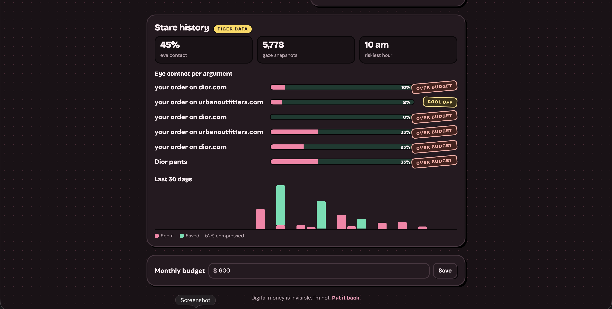

# PiggyBack

**A robot piggy bank that judges your online purchases.** Built at MakeCU 2026 (Columbia's hardware hackathon), Creativity track.

> *"Put it back."*

Digital money is invisible. PiggyBack gives your spending a physical, expressive presence. When you click **Place order** on a shopping site, PiggyBack's Chrome extension pauses checkout. The pig turns its head toward you, changes its eyes, and asks you two or three short questions out loud about what you're buying.

The catch: you have to answer **while looking it in the eyes**. A webcam in its head checks for eye contact, and its eyes and head follow you around. Look away mid-answer and it makes you say it again. Then it gives a verdict:

- **Release**: go ahead, but only after you hold its stare for 3 seconds.
- **Timer**: a cooling-off countdown before you can buy.
- **Escalate**: too far over budget, so it gets your accountability buddy involved.
  



## Budgeting page





## How it works

| Part | What it does |
|---|---|
| **Chrome extension** (`extension/`) | Holds "Place order", runs the conversation overlay, and quietly notes what pushed you there: the ad you clicked, the countdown timer, the "frequently bought together" upsell. |
| **Brain** (`brain.py`, laptop) | One FastAPI server. Runs the conversation with Gemini Flash, enforces the budget rules, speaks with macOS `say`, and hears your answers on the mic with faster-whisper. |
| **Vision** (`vision.py`) | MediaPipe face landmarks from the webcam in the pig's head: where your face is, and whether you're looking at the eyes. |
| **Memory** (`store.py`, `tiger.py`) | Your budget, savings goals, a "waiting room" of things you were told to wait on, and every past argument. History and eye-contact time series go to Tiger Data (Postgres + TimescaleDB). |
| **Dashboard** (`dashboard.html`) | `http://localhost:8000/`: money left, money saved by letting things go, arguments won, goals, and your stare history. |
| **Body** (`firmware/pig_eyes/`) | ESP32 over USB serial. One 128×64 OLED draws both eyes (pupils follow you, lids close during the stare-down), and one servo turns the head. |

### The rules

The AI asks the questions, but code has the final say, and it can only make a verdict stricter:

- **Fits the budget easily**: 2 questions, and the AI's verdict stands.
- **Uses more than half of what's left**: 3 questions. A release only stands if every answer was spoken with unbroken eye contact.
- **Over budget**: 3 questions, and it escalates unless you argue it with full eye contact *and* prove it's a real need (your charger broke and the project's due tomorrow). Wants get a timer at best.
- **Look away twice**: the argument ends, and the best you can get is a timer.

The pig's job is to stop impulse buys, not necessities. It also remembers: "Third time this week," or "Last time you said it was a gift."

## Run it

You need macOS (for `say`), Python 3.12, and Chrome. The pig itself is optional: without it, the brain prints the commands it would send.

```bash
python3.12 -m venv .venv && source .venv/bin/activate
pip install -r requirements.txt
```

Sign in to Gemini on Vertex AI once (see [CLAUDE.md](CLAUDE.md#config-environment-variables) for the `.env` settings), or try it without any AI using `LLM_PROVIDER=mock`:

```bash
LLM_PROVIDER=mock uvicorn brain:app --port 8000
```

Then:

1. Load `extension/` in Chrome (`chrome://extensions` → Developer mode → Load unpacked). See [extension/README.md](extension/README.md).
2. Shop at the demo store, <http://localhost:8000/store/>, and click **Place order**.
3. Watch the dashboard fill in at <http://localhost:8000/>.

Before using the camera and mic, run `python check_devices.py` from your own Terminal so macOS asks for permission.

For the judging table, `./demo.sh` seeds three weeks of demo history and keeps the brain running in demo mode, where no real order is ever placed.

### Tests

```bash
python -m unittest discover tests
```

No camera, mic, ESP32, or API key needed.

## Hardware

- ESP32 dev board, flashed with `firmware/pig_eyes/pig_eyes.ino` (Adafruit SSD1306, Adafruit GFX, ESP32Servo)
- SSD1306 0.96" 128×64 OLED (both eyes) on I2C, SDA 21 / SCL 22
- MG90S pan servo on GPIO 18, powered from a 5 V bench supply (never the ESP32's pin), grounds shared, 470 µF across the servo rail
- Logitech webcam mounted on its side just above the eyes, so looking at the eyes means looking at the camera
- The laptop's own mic and speakers

## More

- [extension/README.md](extension/README.md): the Chrome extension and the ad/upsell signals it notices.
- [bot/README.md](bot/README.md): optional Playwright browser that watches Amazon, Target, and Walmart tabs.
